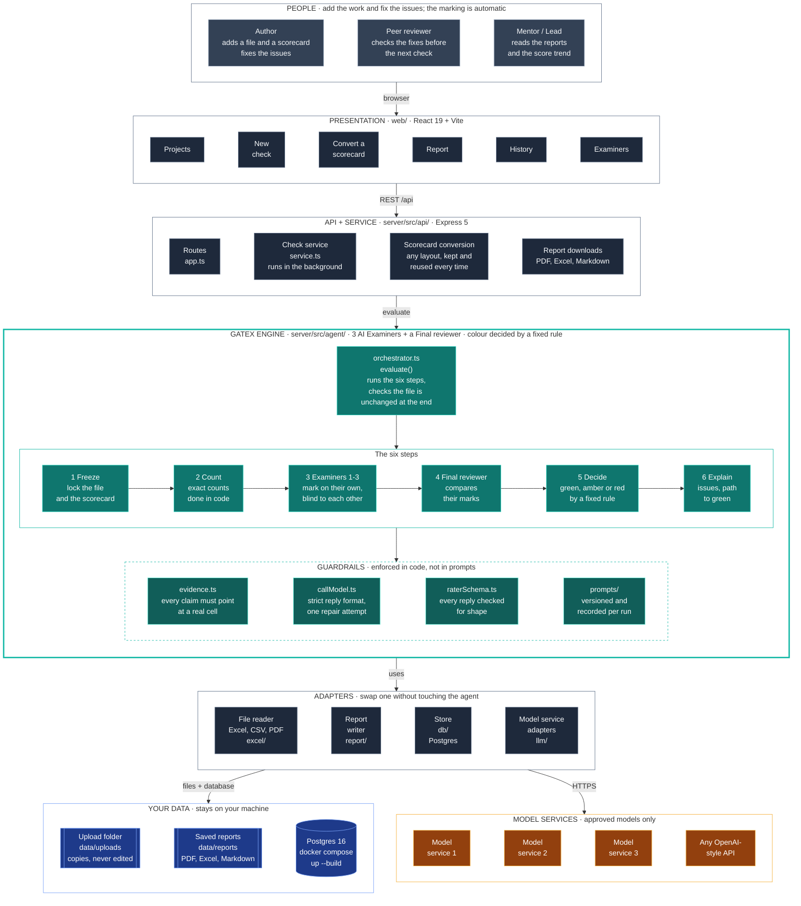
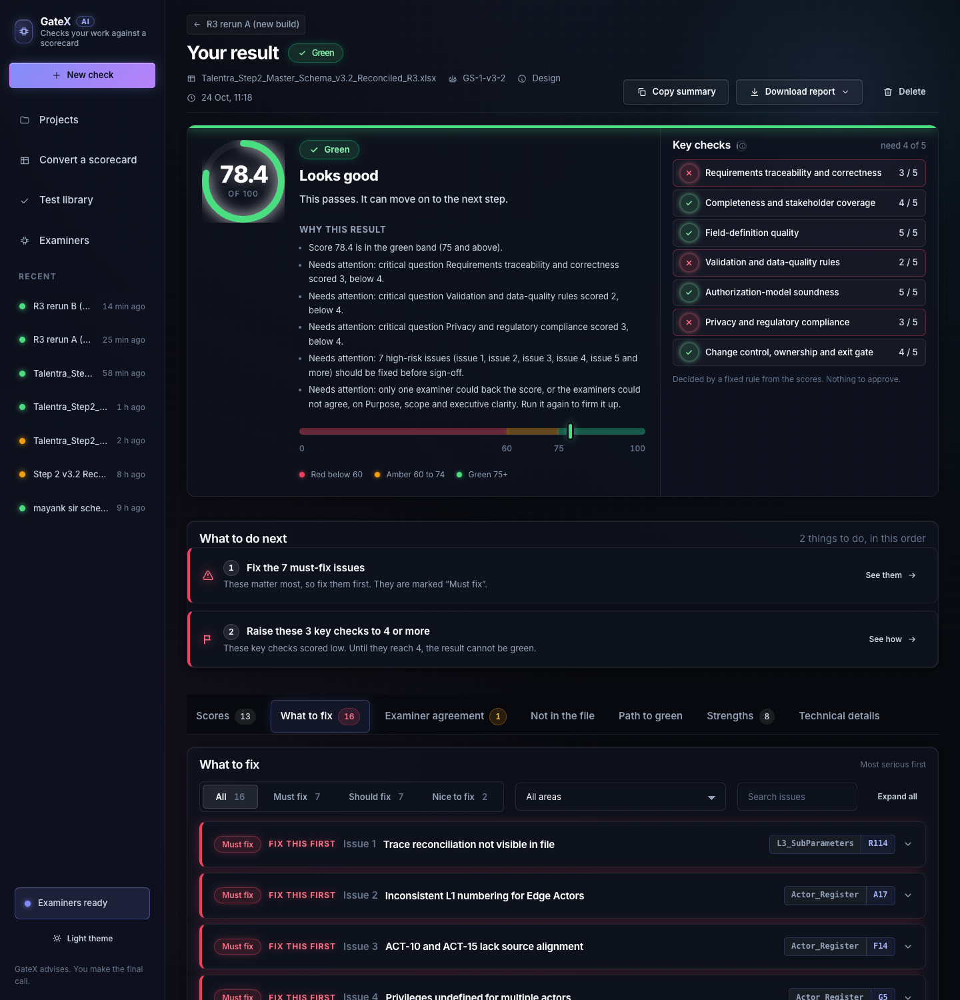
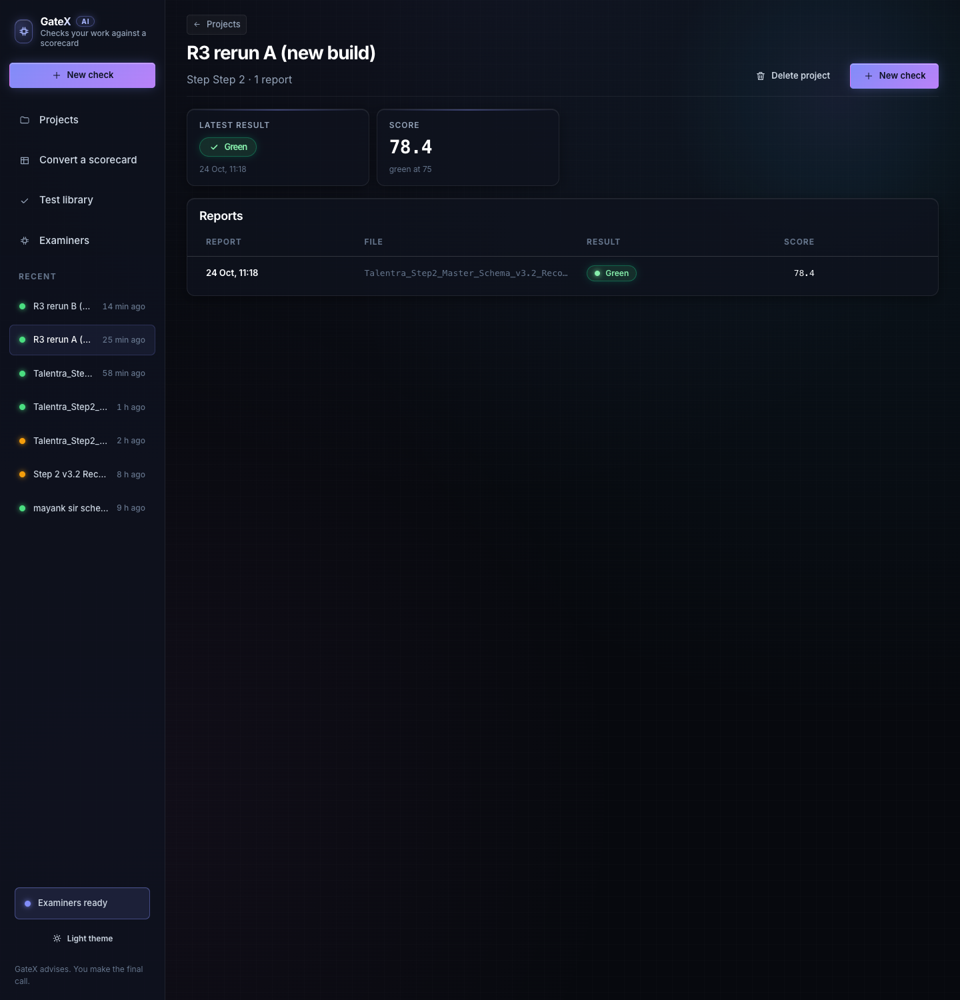

# GateX

**Checks your work against a scorecard.**

GateX takes a file (an Excel sheet, a CSV or a PDF) and a scorecard, which is the list of things the file should get right. Three AI Examiners
mark the file on their own, and a Final reviewer compares their marks. A fixed rule, not an AI, then decides whether the result is **green, amber
or red**, and a plain report shows what to fix first and the quickest way to green. You fix the file, check it again, and watch the score climb
until it is green.

---

## How it works

1. **You add two things:** your file and your scorecard. The scorecard can be in almost any layout: Excel, CSV, PDF or plain text. GateX
   reads it and keeps it, so every round is marked against the same scorecard.
2. **GateX counts what can be counted.** Blank cells, repeated ids, lists that do not match: code checks every row, so those numbers are exact.
3. **Three AI Examiners mark the rest.** Examiner 1, Examiner 2 and Examiner 3 each give every question a mark from 0 to 5. They do not see each
   other's marks, and every mark has to point at a real cell in your file.
4. **A Final reviewer compares their marks.** Where the Examiners agree, the mark stands. Where they differ, the Final reviewer looks at the
   evidence in the file, and the lower mark stands unless the evidence supports a higher one.
5. **A fixed rule picks the colour.** The score is out of 100. **Below 60 is red, 60 to 74 is amber and 75 or more is green.** The same rule
   is used for every scorecard, so the colour always means the same thing.
6. **You get a plain report.** It lists the issues in the order to fix them, with the cell where each one is, and a path to green. It comes as
   a PDF with charts, an Excel workbook and a Markdown file.
7. **You fix and check again.** Every round is kept, so the project page shows the score moving up.



> The same diagram as a static image, for viewers that do not draw Mermaid: [`docs/images/architecture.svg`](docs/images/architecture.svg).

More views are in [docs/architecture.md](docs/architecture.md): the system, one check from start to end, the loop to green, the data, and
how it is deployed. The security view is in [docs/security.md](docs/security.md).

## What you get


- **A verdict:** one score out of 100 and one colour.
- **Issues, in order:** each marked **Must fix**, **Should fix** or **Nice to fix**, with the sheet and cell, what is wrong and how to fix it.
  The ones to fix first sit at the top.
- **A path to green:** the smallest set of fixes that lifts the score to the next colour, with the points each fix adds.
- **A report to keep or share:** PDF (with charts), Excel and Markdown. The PDF and the first Excel sheet open with "What to improve".
- **A history:** every round of a project is saved, so you can see the score trend and which issues were fixed, which remain and which are new.

| The report, with the verdict and scores | The score across rounds |
|---|---|
|  |  |

## Quick start

You need Node 22 or newer.

1. **Install.**

   ```bash
   nvm use                            # Node 22
   npm install
   ```

2. **Build the dashboard.**

   ```bash
   npm run build
   ```

3. **Start GateX.** This demo mode needs no keys and no Docker. The sidebar says **Mock models (demo)** so a demo run is always labelled.

   ```bash
   MOCK_LLM=1 npm run start           # then open http://localhost:4000 (the GateX home page; the dashboard is at /projects)
   ```

4. **Run a check.** Open **New check**, add a file and a scorecard (try `samples/talentra/Talentra-Feature-Discovery-Dashboard.xlsx` with
   `samples/talentra/talentra-schema-d2.xlsx`), give the project a name and start the check. To fill the history with three example rounds, run
   this in a second terminal:

   ```bash
   npm run seed:demo -w server
   ```

5. **Read the report, fix, and check again.** Start at the top of the issue list, fix what you agree with, and add the file again under the same
   project name. Repeat until the colour is green.

Every finished report is also saved in `data/reports/<project>/iteration-<n>/` as `.json`, `.md`, `.xlsx` and `.pdf`.

**To use real models** with everything saved to Postgres, copy `.env.example` to `.env`, add your keys, and run `docker compose up --build`
(open http://localhost:4000). Full setup is in [docs/operations.md](docs/operations.md).

**From the command line**, with no server:

```bash
npm run evaluate -- --workbook samples/talentra/Talentra-Feature-Discovery-Dashboard.xlsx \
                    --scorecard samples/talentra/talentra-schema-d2.xlsx --mock \
                    --instructions "Be strict about definitions."       # optional
```

## Your scorecard

The scorecard can be an Excel file, a YAML file, or almost any other layout (a workbook, CSV, PDF or text). Download a ready-to-edit Excel
template from **New check**, or start from `samples/talentra/talentra-schema-d2.xlsx`. There is also a box for **extra instructions** to the
Examiners, which is saved with the result. A scorecard in another layout is converted once and reused, and **Convert a scorecard** in the
sidebar shows you what was understood. The format is described in [docs/scorecard-reference.md](docs/scorecard-reference.md).

## Where to read more

| | |
|---|---|
| [docs/user-guide.md](docs/user-guide.md) | One page for authors: add a file, read the report, fix and check again |
| [docs/agent.md](docs/agent.md) | What GateX does at each step, the safeguards, and where each part lives |
| [docs/architecture.md](docs/architecture.md) | How the parts fit together, the data and the deployment |
| [docs/scorecard-reference.md](docs/scorecard-reference.md) | Writing a scorecard: fields, questions, checks, bands |
| [docs/api.md](docs/api.md) | The endpoints, with examples |
| [docs/operations.md](docs/operations.md) | Setup, configuration, models, database, backup, running on a server |
| [docs/security.md](docs/security.md) | How your files and keys are protected |
| [docs/pdf-traceability.md](docs/pdf-traceability.md) | How GateX follows the Agentic Roadmap, page by page |
| [docs/decisions.md](docs/decisions.md) | The design decisions and the reasons for them |
| [docs/development.md](docs/development.md) | Working on the code: conventions, tests, recipes |

All the documents are listed in [docs/README.md](docs/README.md).

## Quality

```bash
npm run typecheck      # shared, server, web
npm test               # server and dashboard tests, all repeatable
npm run docs:check     # every doc link, anchor, path and folder tree is real
```

The tests cover every safeguard, the way GateX handles a model that answers badly, defects planted in a real file that must never come out
green, the API and the history. Details are in [docs/development.md](docs/development.md#testing).

## Built with

TypeScript on Node 22, Express 5, React 19 with Vite, Postgres 16 with plain SQL, Zod for checking every input, and Vitest. Models are
reached over plain HTTPS. The reasons for each choice are in [docs/decisions.md](docs/decisions.md).
