# The GateX engine

> **Where is the engine?** In one folder: [`server/src/agent/`](../server/src/agent/).
> The entry point is [`orchestrator.ts`](../server/src/agent/orchestrator.ts), function `evaluate()`.
> The rest of the application reaches it only through [`agent/index.ts`](../server/src/agent/index.ts).

This page explains what GateX does with your file, step by step, and which file does each part. (The folder is still called `agent`.) It is the
Level 1 evaluator from the *Talencia Global · Data-Driven Development · Agentic Roadmap* (pages 9-14). For the whole system around it, see
[architecture.md](architecture.md).

---

## 1. What the engine does

You give GateX a file (a schema or an output document) and the scorecard that says how to judge it. GateX marks every question in the
scorecard, decides **green, amber or red**, and explains the result: where each issue is, how to fix it, and the smallest set of fixes that
would turn the result green.

- It **reads** your file and never changes it. The file is fingerprinted (hashed) before and after, so you can see it stayed the same.
- It **counts** what can be counted in code, so those scores are exact.
- It asks **three AI Examiners** to mark the rest independently, and a **Final reviewer** to compare their marks.
- It decides the colour with **a fixed rule** (a function), never with an AI.
- It follows a **fixed flow**, so every step can be enforced and tested. Your part is to fix the file and check it again.

## 2. The folder

```
server/src/agent/
├── index.ts            public API: evaluate(), buildVerdictSection(), buildPathToGreen(), PROMPT_VERSION
├── orchestrator.ts     ★ evaluate(): runs the six steps in order        (start reading here)
│
├── checks/             step 2: exact checks done in code
│   ├── library.ts        the built-in checks
│   ├── index.ts          runs a scorecard's counted questions, share → 0-5 by bands
│   └── types.ts
│
├── prompts/            versioned prompts (PROMPT_VERSION)
│   ├── rater.ts          what each Examiner is told
│   └── consolidator.ts   what the Final reviewer is told
│
├── rater.ts            step 3: runs one Examiner, keeps only evidence-backed claims
├── fallback.ts           backup models: same Examiner, same family, tried in order
├── twoRuns.ts            the optional "run twice" mode: two full evaluations, their average, the gap and the unstable note
├── repeats.ts            the median of one Examiner's repeated runs of a section, which questions are asked again (disputed, and heavy ones), and the heavy-question rule
├── finalMark.ts          step 4: the final mark by code: the median of the Examiners' marks, stray marks that need proof, how far the Final reviewer may move it
├── sectionPlanner.ts     groups questions into sections by the sheets and columns they `reads`
├── autoReads.ts          gives a question that names no sheets the sheets that match it, when the whole file is large
├── prompt.ts             builds what the Examiners are sent, one prompt per section (shared with the pre-submit check)
├── preflight.ts          before running: can enough Examiners take this prompt?
├── callModel.ts          one model call + the "repair" retry on a reply in the wrong shape
├── raterSchema.ts        the exact shape a model reply must have
├── evidence.ts           "does this cited cell really exist, and does the quote appear in it?"
│
├── consolidate.ts      step 4: the Final reviewer compares three Examiners; code enforces the PDF rules
│
├── verdict.ts          step 5: weighted score, must-pass questions, green / amber / red
├── findings.ts         step 6: issues from code checks, ids, ordering
├── findingCheck.ts     step 6: sets aside issues the file contradicts or that say nothing, and merges repeats
├── claimCheck.ts       step 6: code-only checks: a named field or id the file does define, a cited cell that says something else, a gap the file already marks as open
├── presence.ts         step 6: sets aside "the file has no X" issues when a cell really holds X (the Final reviewer finds it, code proves the quote)
├── verifyFindings.ts   step 6: the second look: a separate model reads each Examiner issue against the file; set aside only on a cell and words that code finds in the file
├── reliability.ts      step 6: the lone-examiner rule, from what the test library measured
├── sweep.ts            step 2/6: the row-by-row sweep in code (empty cells, repeated ids, dangling references, ids cited but defined nowhere, wrong counts, filler)
├── pdfSweep.ts         step 2/5/6: the same row checks over the tables of a PDF (rows rebuilt from the page, wrapped cells joined, one table across pages)
├── sweepDeep.ts        step 5: more exact counts used only for scores (id pattern, cross-sheet references, orphan rows, slipped values, parent width, repeated reasons)
├── exactScore.ts       step 5: counted criteria scored by an exact count (a ceiling the Examiners cannot raise)
├── anchorFloor.ts      step 5: a score below the lowest rung the scorecard's own scale describes is raised to it (when the cited cells are there)
├── tallies.ts          step 2/6: recounts the figures a file states about itself ("68 fields", "283 of 426 (66%)", "COUNT ... 50 L4 leaves")
├── pathToGreen.ts      step 6: smallest set of fixes that lifts the colour
└── types.ts            internal types (Examiner outcomes, draft issues, call metadata)
```

What the engine **uses** but does not own: `llm/` (talks to the model services), `excel/` (reads
files), `util/` (hashing, small helpers). What it keeps clear of: `api/`, `db/`, `report/`. That boundary
is checked in [architecture.md](architecture.md#dependency-rules).

## 3. Inputs and outputs

| | |
|---|---|
| **In** | The file path · the parsed, frozen **scorecard** (from an Excel, YAML or JSON file, and its hash) · optional **source documents** and optional **extra instructions** (text) · the model **roster** (3 Examiners + a Final reviewer) · a run id, project name and iteration number |
| **Out** | `EvaluationOutput`: the unchanging **core** (header, per-question results, issues, strengths, notes), one record per model call (prompt, raw reply, what was set aside), and a **run log** (models, hashes, timings, tokens) |
| **Side effects** | None on your file. Progress events go to a callback so the dashboard can show live status. The engine itself does not touch the database. |

The verdict, the "not in the file" list and the path to green are **worked out** from the core (plus an override, if one was
recorded through the API) whenever a report is read, by `report/assemble.ts`. The core never changes after the run.

## 4. The six steps



### Step 1 · Freeze  (`orchestrator.ts`)

Fixes the inputs so the target stays put (PDF p.13).

1. Locks the scorecard by its hash.
2. Checks the roster: three Examiners from **three different model families**, every model on the **approved**
   list, every service has a key (`llm/roster.ts`).
3. Reads the file **once**, takes its SHA-256, and parses it from those bytes.
4. Checks that every sheet the scorecard names exists, and builds the set of sheets an Examiner may cite.
5. At the very end it reads the file again and compares the hash, which proves the file stayed the same.

### Step 2 · Count in code  (`checks/`)

Questions marked `measured_by: code` are counted exactly by a built-in check: "how many of these rows are right?", for example
*"168 of 169 nodes have a definition"*. The pass ratio is turned into a 0-5 mark by the question's `bands`. The checks are listed in the
[scorecard reference](scorecard-reference.md#built-in-checks): `max_value`, `column_filled`, `unique`, `any_filled`, `list_refs_resolve`,
`lists_referenced`, `values_in_list`, `value_not_in`, `row_count_at_least`, and the text checks `text_terms_absent`, `text_terms_present`
and `text_ids_valid` (they count lines of text, so they work on a PDF).

Why code for these: code is exact, free and repeatable, so counted questions get the same score every time. This is the one place the build
goes beyond the PDF's wording (see [decisions.md](decisions.md#adr-3-code-scores-the-countable-dimensions)).

A check that has nothing to read (for example a missing column) marks its question **unscored**, which counts as 0, and a HIGH issue says
why, so a missing mark never helps the score.

### Step 3 · Examiners 1, 2 and 3 mark  (`rater.ts`, `callModel.ts`, `evidence.ts`, `prompts/rater.ts`)

The three Examiners work **at the same time**, each in its own call, and each is sent exactly the same prompt:

- the frozen scorecard (the questions the Examiners mark, with their 0-5 anchors),
- your file: every non-empty cell written with its address, for example `H5="Which product..."`,
- the context sheets and the source documents,
- the **extra instructions** typed at submission, if any. The same words go to every Examiner and to the Final reviewer, and are saved in the
  report header with a hash. The rules say these instructions can steer what to look at and can never change the anchors, the 0-5 scale, the
  evidence rule or the reply format, and cannot say what mark to give.
- the rules: *mark each question 0-5 using only the anchors, cite the cell, never invent, reply in the set format only*.

Nothing else is in the prompt: no other Examiner's mark, no self-assessment by the author, and no code-check results. That is what makes the
marking blind (PDF p.13). The scorecard's `columns` option trims what the Examiners see so the prompt stays compact. A question can also list
`reads`, the sheets and columns it needs. Questions with the same `reads` form a **section**, and each section is its own smaller prompt (see
*Sectioned scoring* in the scorecard reference). The three Examiners work together inside a section, and sections run one after another. A
question that names no sheets would be sent the whole file; when that is more than 30,000 tokens, code gives it the sheets and columns that
best match its words (`autoReads.ts`, deterministic) and writes the choice in the run notes.

Every reply is checked, not just trusted:

| Check | Result |
|---|---|
| The reply has the right shape (valid format, a `dimensions` list) | If not, the Examiner gets up to two repair attempts that say what to fix |
| A mark is a whole number from 0 to 5 | Other marks are set aside |
| A mark cites a cell that exists, with a quote that appears in it (`evidence.ts`) | "No evidence, no mark": a mark without it is set aside |
| An issue names a known question and a real location | Others are set aside |
| The Examiner says `not_measurable` | Counted as "nothing to mark here", not as a score |

Everything set aside is counted and stored per Examiner, so the report shows exactly what was kept. When a model's input limit is known
(`maxInputTokens` in `models.json`), GateX measures the prompt first and tells you in plain words before running.

If a model is busy, its configured **fallback models** are tried in order. A fallback answers as the same Examiner and counts as the same
family, so independence is kept (`agent/fallback.ts`). The report header names the model that really answered. The Final reviewer has
fallbacks too.

#### Asking again where it matters  (`repeats.ts`, `orchestrator.ts`)

With `repeats` above 1 each Examiner marks every section once, and then a question is **marked again** (`repeats - 1` more times by each Examiner, and the
median of each Examiner's answers is kept) when
- two Examiners differ by **2 points or more**,
- it is a **heavy** question (a criterion of one of the heaviest dimensions: the top quarter by weight, ties included, none on a scorecard of three dimensions or fewer)
  and the Examiners are not all the same, since one point on a heavy question is worth the most and was where the Final reviewer's pick used to swing the score, or
- an Examiner gave no usable mark.

Questions the Examiners agree on are not asked again, which is where most of the saving comes from. Every call, the first answers and the repeats, is made at
**temperature 0** (`settings.temperature`, 0 by default; Bedrock accepts it for every model in the roster). `settings.repeatTemperature` can set a different
temperature for repeat answers only; it is unset by default because models do not repeat themselves exactly even at 0. The run log records the temperature used.

### Step 4 · The Final reviewer compares  (`consolidate.ts`, `finalMark.ts`, `prompts/consolidator.ts`)

The Final reviewer reads the three checked sets of marks plus the file and proposes, for each question, one mark and a set of merged issues. It
does **not** mark from scratch, and it no longer sets the final mark: **code does**, from the Examiners' marks, so the same marks always give the same result
(`finalMark.ts`). The PDF's rules still hold (PDF p.10): lower on ties, no mark without evidence, never a mark outside what the Examiners said.

1. **A stray mark needs proof.** A **0**, or a mark that is 2 or more points from two Examiners who agree, counts only when the cell the Examiner cited holds the words
   it quoted (a quote of 8 characters or more, or most of what a short cell says). Without that proof the mark is **set aside for that question** and logged. A 0 that
   two Examiners share is not a stray, and neither is a 0 on a question that needs evidence from outside the file (there a 0 means "not in the file").
2. **The final mark is the median** of the marks that count: the middle one, and the lower middle when two are left, so a tie never rounds up.
3. **The Final reviewer can move the median only with checked evidence.** It must cite cells code confirms exist and hold its quote. It may move the mark all the way
   to a mark an Examiner gave when that Examiner cited one of the same cells; otherwise by one point at most. A suggestion with no checked cell is refused. Every
   set-aside mark, move and refusal is written in plain words into the question's `markNotes` and into `run-log.json` (`markLog`), with a total in the report notes.

| Situation | Result |
|---|---|
| Every Examiner declined | The question is **not in the file**: left out of the score (`unmeasured: skip`, the default) or counted as 0 (`zero`) |
| No Examiner gave a valid mark, but some were set aside | **Unscored**: counts as 0 and is flagged |
| Only one Examiner's mark is left (one gave a mark, or the other was a stray without proof) | That mark, flagged as backed by one Examiner |
| Examiners differ by **1 point or less** | The median (the lower middle for two), moved only as above |
| Examiners differ by **more than 1** and the Final reviewer's mark, after the rules above, is the final mark and is backed by a cited cell | That mark, marked as checked |
| Examiners differ by more than 1 and nobody settled it with evidence | **The median stands**, and the question is flagged as uncertain |

So the Final reviewer can never invent a mark outside what the Examiners said, and the choice between near-identical marks, which used to swing a question by 3 or 4
points between runs, is made by a rule. Repeated issues are merged, the highest severity of any member wins (merging never softens an issue), and any issue the
Final reviewer did not merge is kept.

### Step 5 · Decide by a fixed rule  (`verdict.ts`)

A plain function, never an AI (PDF p.12).

```
weighted score = sum(weight × mark) × 100 / (5 × sum of weights counted)
```

Every counted and Examiner-marked question is included (an unscored one counts as 0). A question with nothing in the file to mark is left out,
or counted as 0 with `unmeasured: zero`. A question written for a person (`measured_by: human`) is simply an Examiner question: the Examiners
mark what the file records about it.



The colour comes from the score alone ([ADR-18](decisions.md#adr-18-one-colour-rule-for-every-score-decided-by-the-score-alone)): **below 60 red,
60 to 74 amber, 75 to 100 green**, the same rule for every scorecard. A must-pass question below 4, a **HIGH issue** ("Must fix"), a mark only one
Examiner backed (or one the Examiners could not agree on) and a score built on a small part of the scorecard (less than half of the weight, `MINIMUM_COVERAGE` in `verdict.ts`) are
listed first as **Needs attention** notes. They do not change the colour. When the server starts, it refreshes any saved result that an older
version of this rule coloured differently. The score is compared unrounded and shown rounded **down**, so 74.96 is never shown as 75. An
optional override (API only, with a written reason) is shown next to GateX's own verdict, which stays on record.

#### Close to a colour line: a second look  (`orchestrator.ts`, `verdict.ts`)

When the score is within **4 points of 75 or of 60** (`CLOSE_TO_LINE`), another run could land on the other side of the line. GateX then looks again, by
code, at the questions the Examiners still differ on by 2 or more (the 8 with the most weight at stake at most): each Examiner marks just those questions
`repeats - 1` more times, the median is taken over all their answers and the Final reviewer reviews just those questions again. The report then says, in plain words and
next to the score, that the result is **close to the line**, what was looked at again (the score before and after), and the **range**: where the score would land if
every question still in dispute went the lowest way, and the highest way. The colour is still the score's band and nothing else. The setting `closeLook` (on by
default) can turn the extra calls off, and a Quick check never makes them; the plain-words note stays either way. A run-twice result skips it (its average and gap already say how wide the result is).
The run log records the questions and the number of calls (`secondLook`).

#### Optional: run twice  (`twoRuns.ts`)

Scores move a little from run to run, and a score near a line (75) can land on either side of it. **Run twice** (`evaluateTwice`) does two full
evaluations in a row with the same Examiners and settings, and scores each with the rule above. The report's score is the **average** of the two,
and the colour comes from that average by score alone. The report also shows both scores and the **gap** between them. If the gap is **8 points or
more**, or the two runs land on different colours, the report adds a "Needs attention" note, "Result is unstable, treat it as a range"; the colour
does not change. The areas, issues and path to green come from the run closest to the average. It is off by default (API `runTwice=1`, CLI `--twice`,
a tick box on the upload page), costs about twice as much, and works with adaptive repeats and Quick check unchanged, since each run is an ordinary
evaluation. Both runs' tokens and timings are added together in the run log.

### Step 6 · Explain  (`findings.ts`, `pathToGreen.ts`)

- **Issues.** Every code check that is not perfect becomes an issue pointing at the failing cells, with a fix taken from the scorecard.
  Examiner issues are added after the Final reviewer. Each gets an id (`F-01`...), a severity, the stage to return to, and who raised it.
  The severities are **HIGH** (shown to people as "Must fix"), **MEDIUM** ("Should fix") and **LOW** ("Nice to fix").
- **Path to green.** Plain arithmetic. First lift every must-pass question below 4, then raise the questions that add the most weighted score
  until the next colour is reached. Each step shows its gain (`4 → 5, +2.6`) and the HIGH issues to fix first.
- **A plain report.** The PDF (with charts), Excel and Markdown reports are built from the core by `report/assemble.ts`.

**Two tiers: Confirmed and Worth a look** (`shared/src/tiers.ts`, applied in `orchestrator.ts`, read again in `report/assemble.ts`). Examiner judgement calls are wrong
or too vague about a third to a half of the time, and a quote check cannot disprove a judgement. So the report separates what is dependable from what is a lead, by a fixed rule on fields
already on the issue (no model decides it):
- **Confirmed**: found by code (sweep, exact count, tally), or raised by 2 or more different examiners, or proved by code reading the cells it names (`proof`, set in `findingCheck.ts`), or
  raised by one examiner whose model family has been useful on at least half of its lone issues over 20 or more checked issues (`loneFindingTrusted` in `reliability.ts`, from `data/library/reliability.json`).
- **Worth a look**: every other issue, that is a single examiner's judgement call that passed the filters. A family with too few checked issues is not trusted, so a new roster starts with its lone issues here.
The headline uses Confirmed only: the "Needs attention" must-fix note, `blockingFindings`, the path to green, the key numbers, the issue list and the issue numbers. Worth a look is shown apart and last
(dashboard: a closed section under the issue list; PDF: its own section near the end; Excel: a "Worth a look" sheet; Markdown: a collapsed block), numbered "Look 1, 2...", in plain words with no model names.
**Scores and colours do not depend on the tier** (the colour is the score's band). Each issue carries `tier` and `tierReason`; reports saved before tiers get a tier from the same rule when they are opened (without the
lone-examiner trust, which needs the roster).
Measured offline with `npm run tiers:measure` (13 labelled runs, 171 issues kept by the filter, our labels): all kept 43% useful, 21% wrong, 33% vague. Confirmed (122): 58% useful, 16% wrong, 23% vague. Worth a look (49):
6% useful, 31% wrong, 57% vague. Confirmed keeps 23 of 23 real and 71 of 74 real-or-partly issues (96%); 3 partly-right issues sit in Worth a look. With the consensus labels (`--consensus`): all kept 40% useful, 24% wrong;
Confirmed 55% useful, 20% wrong, keeps 18 of 18 real and 67 of 68 real-or-partly. Wrong share falls only a little because two examiners often agree on the same mistake; most of the gain is fewer vague issues on the headline.
A single HIGH issue from one examiner is 45% wrong, so severity is deliberately not a reason to confirm. Small sample, labels by an agent, not a human.

**What a run cost** (`report/cost.ts`, `agent/usage.ts`). The run records tokens in and out per model (each examiner, the final reviewer, the fact-check calls). The report shows one line and a small table by "Examiner 1 / Final reviewer / Fact checks".
Prices are optional, in `server/config/prices.json` (`perMillionTokens` by model id; `PRICES_CONFIG` points elsewhere). A model with no price shows tokens only, and the total says when only some models have a price.

**The row-by-row sweep** (`sweep.ts`). Models read a whole sheet and skim it; code reads every row. Whatever the scorecard asks, code finds what
is off by the file's own pattern: an empty cell in a column that is otherwise full, a repeated id, a reference to an id that does not exist, a
child count that does not match the rows, a definition made of filler, an id cited in text that is defined nowhere (`D3-S14-P15` among
`D3-S14-P01..P09`), a cell empty on a row of a kind that always has it, a value in a Required column that is not a way of saying required or
optional, and a tally the file states about a sheet that is a little off ("278 parameters" for 276 rows, LOW). Each is an exact code issue at one
cell, attached to the scorecard question with the most words in common, and the cleaning steps below never touch it.

**PDF tables** (`pdfSweep.ts`, fed by `excel/pdfTables.ts`). A PDF page is one column of text lines, so the sweep used to skip it; now the tables of a PDF are
swept like sheets. The reader lays each table out on its own header (the columns are where the header's words start, so a word repeated inside a wide cell
is not a column), joins a cell that wraps over several lines into one cell, puts a dash-wrapped id back together (`F-` / `S21-` / `01`), and keeps the
rows with the line they sit on. Pages whose header is the same table (the docket repeats `ID | Field | What to write | ...` on every page) become ONE table, a
row that breaks across a page (its first column empty) is joined to the row it continues, and then the same checks run on it: empty cells in a full column,
repeated ids, dangling references, child counts, filler, a Required column with odd values, and (for exact scores) the id pattern, parent width, slipped
values, copied reasons. Findings point at the page and line where the row sits (`Page 41!A12`). Strict on purpose, because a PDF has no cell borders: a
table is swept only when its header is plain words (several different short cells, no digits, none cut mid-word) and repeats on two pages or more (a data
row misread as a header never does); a row is left out when a cell runs under its empty neighbour (a merged cell), when only one or two of five or more cells
are filled (a heading band), or when it is cut where the text does not allow; a table where more than one row in ten is such a fragment (text centred in tall
cells) says nothing; pages with no header are not read at all. Every sheet rule keeps its own "the column plainly follows the pattern" test on top. For the
id pattern, ids of a second family (`F-RB-01..12` beside `F-S21-04`) are not slips: only an id shape seen once or twice counts.

The sweep also keeps the score honest (`capByExactFindings`): a question the sweep found mistakes under keeps a mark of at most 4 (one or two
mistakes), 3 (three to five) or 2 (six or more), whatever the Examiners gave it. The cap is named in the question's rationale and in the run notes.

**Exact scores for counted criteria** (`exactScore.ts`). A criterion that is a count ("no duplicate ids", "every field has a definition, a type and a
reason", "every reference resolves", "list fields hold only allowed values") is counted by code over every row, and its score is set from a fixed
rule that the Examiners cannot raise. Before the criteria are combined into their dimension, each Examiner-scored criterion is compared with the
ceiling the count allows and lowered to it if it is higher; a score is never raised (a clean count proves only that these mistakes are absent). The
rule is the same everywhere:

| Clean share of the rows looked at | Score | | Wrong tallies | Score |
|---|---|---|---|---|
| 100% | 5 | | 0 | 5 |
| 99% or more | 4 | | 1 | 4 |
| 97.5% or more | 3 | | 2 | 3 |
| 95% or more | 2 | | 3 | 2 |
| 90% or more | 1 | | 4 | 1 |
| below 90% | 0 | | 5 or more | 0 |

Any mistake at all caps a share-scored criterion at 4. "Rows looked at" is every data row of the sheets the sweep ran over (every id for repeats, every
reference cell for references, every Required cell for allowed values); a row with two mistakes in one family counts once. A criterion is made exact
only when its own words name the count:

| Family | The criterion says | Counted by the sweep |
|---|---|---|
| empty cells | "no blank cells", "every field has a value / a definition, a type and a reason" (only the columns it names) | empty cell in a full column; empty cell on rows of a kind that always has it |
| repeated ids | "unique", "no duplicates" | the same id on two rows |
| references | "resolves", "no dangling / orphan / broken reference", "ids cited exist" | reference to an id that does not exist; id cited in text and defined nowhere |
| allowed values | "hold only allowed / valid values" | a value in a Required column that is not required / optional / conditional |
| child counts | "children count matches / is correct" | a "Children" figure that is not the rows under that id |
| tallies | "counts match", "reconciled", "totals add up" | a tally the file states that its own rows contradict |
| id pattern | "ids follow NFR-nnn", "id pattern", "well-formed ids" | an id that breaks the pattern the criterion states (else the one shape 97% of the ids share) |
| parent width | "no parent has more than 10 children", "15 children or fewer", "<= 15 children" | a parent with more children than the limit the criterion states (path ids or a Parent column) |
| reasons | "reasons that do not restate the definition" | a Reason cell that is the definition of the same row copied over |
| filled cells (wider wording) | "Definition present", "Cell fill", "Fields with a type", "Atomic leaves with definition, type, reason" | same as empty cells, only the columns named |
| references (wider) | "foreign key", "cross-sheet", "no orphan rows", "every row has a parent" | a value that is not an id of the sheet the rest of its column points at; a path id (1.2.3) whose parent (1.2) is not a row |
| allowed values (wider) | "controlled vocabulary", "from the allowed list" | a value used once or twice that is only a case or one-letter slip of a value most rows use ("high" among "High"), in a column the question names |

Everything else stays a judgement. "Every allowed value has a plain meaning" and "no section has more than 10 children" are not counts of the
families above, so they get no ceiling. The ceiling is named in the criterion's rationale and in the run notes ("SC-03 was set to 3 (the examiners
gave 5): code counted 1 of 79 (1.3%) repeated ids"). Only the Examiners' score moves; the issues the sweep found are listed exactly as before.

**Deep checks** (`sweepDeep.ts`) feed those ceilings only; they are not listed as report issues, so a rule that is wrong about an unseen layout can lower one
criterion's ceiling but never adds an issue for the author to chase (the ceiling's note names up to three of the wrong cells). Each stays silent unless the column
plainly follows the rule almost everywhere (for example a cross-sheet reference needs 90% of the column to be ids of one other sheet, and the column or the sheet must
share a word with the other; an id shape needs 97% of 30+ ids). Wording is matched by whole words, and a deep check counts for a question only when the question
names its column or sheet (or says "orphan"). Wording about a limit, a choice or a mechanism is never a fill count: "every table stays small (at most 40 columns)",
"every rule states X or a schema-wide rule covers it", "the gate detects duplicate and orphan requirements" get no ceiling.

**The anchor floor** (`anchorFloor.ts`). A scorecard that describes its scale as "5 a machine-readable schema matches the prose; 3 structured tables but no machine
format; 1 prose only" has 1 as its lowest rung, so a 0 for a file that has the prose is below the scale's own bottom. (The converter spreads "1 prose only" over 0
and 1, so the same floor is found in the converted anchors.) Code raises such a score to the rung when all of these hold: the lowest described rung is 1 and does not
say absent / none / missing; the question is scored and is not one that needs evidence from outside the file; and at least one cited cell exists, holds text and
contains the quote given with it. The note ("G07-C05 was raised from 0 to 1: ...") is in the report notes and the question's rationale. A scale that starts at 2
("2 several") leaves 0 and 1 undescribed, so nothing is raised there. The floor is applied before the exact ceilings, so a counted mistake can still lower the score.
**Self-reported tallies** (`tallies.ts`, and `sweepStatedCounts` in `sweep.ts`). A file that says "278 parameters", "68 fields" or "100% covered" makes a
claim its own rows can settle, and Examiners tend to accept it. Four kinds are recounted, each only where a deterministic rule exists; a mismatch is
a MEDIUM code issue at the cell that states it, and it caps a criterion that asks for correct counts (table above):

- **a count next to a sheet's name** ("278 parameters" beside a sheet called `L2_Parameters`): compared with that sheet's data rows (a slip of up to 15% is read as a tally; a far figure is about something else);
- **arithmetic** ("283 of 426 fields (66%)", "71/71 100%"): the percentage must be the first number over the second;
- **a field dictionary** (a PDF page listing `name | definition | type | allowed | M or C | source` under "S2 · Workflow register" headings): each overview tile ("14 fields"), the totals ("8 sections · 68 fields") and "Mandatory · conditional fields 56 · 12" are compared with the rows counted under the headings;
- **section tables** ("L1·2 ... L4=50" with "COUNT | ... 50 L4 leaves" at the bottom): the leaf ids (STEP-01, WF-02, a prefix that opens cells of the table) are counted per table and in all ("92 leaves").

A recount from a PDF is trusted only where it agrees with the document on most of its tiles or tables (60% of tiles, two thirds of tables); where it
agrees with few it is probably misreading the layout and claims nothing. Percentages of coverage ("100% covered") are recounted only when they are a
fraction written out ("N of M"); a bare percentage with no rows to count is left alone.

**Supporting rows** (`supporting.ts`). A question that names sheets to read shows the examiners only those, but what it asks about is often defined on another
sheet. So each section also receives the few rows of the rest of the file that share the most distinctive words with its questions (rare words count more),
shown with their header row and cut to fit beside the section for an examiner with a small prompt limit. Decision logs, corrections and comparisons are never
used. Examiners cite these cells like any other.

**"The file already has it"** (`presence.ts`, after the cleaning below). An Examiner may say "the file has no X" about an X the file defines in
other words or on a sheet it did not read. For each such issue, code picks the eight rows most likely to hold X (rare words count more) and the
Final reviewer is asked whether one of them does. Its answer is never trusted alone: it must give a cell and copy the words that define X, and
code checks that the cell (or its row) holds those words and shares a distinctive word with the claim. Cells on discussion sheets (decisions, logs,
comparisons, open questions) never count, and neither does a cell that is itself a placeholder (proposed, unspecified, still to add). When an issue names ids
("D3-S04-P27..P29 are not defined"), the rows that define them are looked up first. "Incomplete" and "not yet added" wordings are checked like "missing". Only then is the issue set aside, with the cell named in the set-aside list. This check can only remove
issues, and if the proof does not hold the issue stays. `npm run presence:eval` repeats the measurement on the labelled examples in
`data/presence/step2-labels.json` (39 labelled issues). Repeated, it sets aside 6 to 8 of the 21 issues the file already answers and none of the 18 real gaps.

**The second look at every issue** (`verifyFindings.ts`, after the presence check; on by default). The presence check only covers "the file has no X". This pass
reads every remaining issue the Examiners wrote, whatever it claims, next to the rows of the file it is about. Issues found by code (the row-by-row sweep, exact counts,
recounted tallies) and issues that already carry a code fact-check note are never sent, and never set aside. For each issue, code picks the rows (the sheet's header row, the cited
row and its neighbours, and the rows holding the claim's rarest words, with the rows that define any id it names first), several issues go to the model in one call, and the model
answers true, false or unsure. An issue is set aside only when four things all hold:
1. the model says the claim is **false** and names one cell and copies, word for word, the words in it that show that;
2. code finds those words in that cell (or its row), the cell is not on a discussion sheet (decisions, logs, comparisons), and it is not itself a placeholder (proposed, TBD, still to add);
3. the quote, its cell or the name of its column shares a distinctive word with the claim;
4. a **second reading** agrees: two other models are each shown the claim, the cell the issue points at and the full text of the quoted cell, and both must answer that the cell contradicts the claim.
   "Partly", "no", a reply that cannot be read, or a model that is down all keep the issue.
No quote, a quote that is not in the file, or "not sure" keeps the issue. The pass can only remove issues. Each issue it sets aside is listed with its cell and quote in the report's
set-aside list and in `run-log.json` (`verification`: the model, the number checked and set aside, the calls, the tokens in and out, and each set-aside issue with its quote). A model that
is down, or an over-long list (more than 120 issues, the most serious are checked first), leaves the rest as they are, with a note. Models: `verifier` in the models file (default: the
Final reviewer, with its fallbacks); `verifier.confirmers` lists the models for the second reading. A **Quick check** skips the pass; so does `"verifyFindings": false` under
`settings` in the models file, or the environment variable `VERIFY_FINDINGS=0`. About 100,000 tokens a run, a few cents to about ten cents on the shipped Bedrock models.
`npm run verify:eval` measures it on every labelled issue (see `CHANGELOG.md`, [Unreleased]).

**Names the file defines, cited cells, disclosed gaps** (`claimCheck.ts`, by code only, before the presence check). Three rules, each needing a cell of the file as proof:
an issue that says a field name (`source_of_truth`) or an id (`D3-S04-P27..P29`) is itself "not defined" is set aside when every such name is a whole cell of the file (in a PDF, a column of
a table row) with a description beside it; an issue that says what its cited cell holds ("H5 contains 'Atomic'") gets a fact-check note when the cell does not hold that (usually the claim is
about another file: the scorecard's H5, not the schema's); an issue whose cited cell is the file's own marker for a gap (UNKNOWN, UNSPECIFIED, To add, CONFLICT, ...) gets a note that the file already marks it
as open. Only the first rule removes an issue; none raises a severity. Measured in `CHANGELOG.md` ([Unreleased]); `npm run replay:blind` scores the rules against the blind labels.

**Cleaning the Examiners' issues** (`findingCheck.ts`, by code, before they are numbered). No model marks its own homework:

| Check | What it does | Example it caught |
|---|---|---|
| Schema asked for filled rows | An issue that a schema's own templates or definitions are "not shown populated" is set aside for a schema-design scorecard; sample content such as personas or permission rows is never touched | "Test links defined but not shown populated" |
| Cells named | An issue that says named cells are empty is tested cell by cell; filled cells are taken out of the claim | "rows 47-52 have no tag" when they do |
| Everything missing | A claim about every field is tested against nearly-full columns on the cited sheet | "no field has a data type" when a type column is 96% filled |
| Missing, but in the file | "X is missing" is set aside if every word of X appears together in three or more places of the file; a claim about a named sheet is tested on that sheet only | "no exit gate" when a sheet `Exit_Gate_Checks` holds 17 checks |
| Vague | A short, hedged issue with no id, number, quote or acronym is set aside | "Some rules are not fully specified, which could lead to..." |
| About the prompt | "The sheet was not provided", "not visible in the provided artifact" describe what the Examiner was shown, so they are set aside | "feature names are not visible" when column G holds them |
| Cannot be measured | An issue about a question the file cannot measure (left out of the score) is set aside | "no evidence of two independent runs" |
| Repeats | Issues in the same question at the same cell with similar wording become one, and so do issues on the same sheet whose words mostly overlap; the other wordings stay in an "Also reported as" note | five issues about one `CONFLICT` cell |
| Lone Examiner | An issue only one Examiner raised is set aside when that Examiner's model family has a low hit rate on lone issues in the test library (at least 20 checked). Read from `data/library/reliability.json`, which `npm run reliability` measures | an issue only one family raised that checking showed was rarely right |

Every set-aside issue is kept in the report with its reason. Only a plain contradiction sets an issue aside, and a severity is never raised. If
the Final reviewer's reply for a batch of questions cannot be read, the batch is split in half and each half asked again (`consolidate.ts`).

## 5. Safeguards

Every safeguard on PDF page 13 is enforced by code, and each has a test.

| Safeguard | Where it is enforced | Test |
|---|---|---|
| Independence: different model families | `llm/roster.ts` checks the roster | `orchestrator.test.ts` › Independence |
| Freeze: fixed and hashed before marking | `orchestrator.ts` hashes first, re-hashes last | › Freeze |
| Blind marking | one shared prompt, built without marks or other Examiners | › keeps raters blind |
| Evidence: unsupported claims set aside | `evidence.ts`, `rater.ts` | `evidence.test.ts`, › discards scores that cite no evidence |
| Lower mark stands (the median of the marks; the lower middle on ties) | `consolidate.ts`, `finalMark.ts` | › keeps the median mark… / › refuses a consolidator score outside the range / `finalMark.test.ts` |
| Read-only | the reader only reads; hash compared after | › never touches the workbook |
| Reproducible | prompts, hashes, models, tokens and set-aside claims stored | `api.test.ts` run log |
| Confidentiality | `llm/roster.ts` approved list | › Confidentiality |

## 6. Staying steady when a service is busy

Model services can be slow or busy. GateX is built to keep going and to say what happened.

| Situation | What GateX does |
|---|---|
| An Examiner's reply is in the wrong shape | Up to two repair attempts that say what to fix, then the Examiner's other sections carry on |
| A model service is rate-limited or busy | The request is retried with back-off (honouring `Retry-After`), then the Examiner's **fallback models** are tried in order, in the same family |
| Only two Examiners can answer | Their marks are used, and every mark only one Examiner backed is flagged |
| The Final reviewer is unavailable | Where Examiners differ, the lower mark is used and flagged, and every Examiner issue is kept |
| A code check has nothing to read | The question is unscored (0) with a HIGH issue that says why |
| The scorecard names a missing sheet or column | You get a message up front that says exactly what to fix |
| A prompt is bigger than a model's limit | GateX tells you before the run, and suggests `columns` or `reads` |

Whatever happens, the report's run notes say how it was produced.

## 7. What is recorded

For every run, in Postgres ([data model](architecture.md#data-model)): the frozen scorecard, both hashes, every model call (the exact prompt,
the raw reply, how many claims were set aside and why, tokens, latency), each question's mark from each Examiner, every issue, and any override.
Given that, any result can be explained and any run repeated.

## 8. Extending it

| To... | Do this |
|---|---|
| Add a built-in check | Add it to `agent/checks/library.ts` and the `CHECKS` map, describe its params with zod, add a test in `checks.test.ts`, and list it in [scorecard-reference.md](scorecard-reference.md) |
| Add a model service | Anything OpenAI-compatible needs only an entry under `providers` in `server/config/models.json`. A different API shape needs an adapter in `llm/` implementing `LlmProvider` and a case in `llm/registry.ts` |
| Change what the Examiners are told | Edit `agent/prompts/*.ts` **and bump `PROMPT_VERSION`**, so old runs stay explainable |
| Change the verdict rule | `agent/verdict.ts` plus its test table in `verdict.test.ts`. The colour rule is fixed on purpose, so change it only on the owner's decision |
| Add a scorecard | Write a YAML or Excel file in the [scorecard format](scorecard-reference.md); no code change |

## 9. Glossary

| Term | Meaning |
|---|---|
| **D1, D2, D3, D4** | Schema design, its scorecard, the output document, its scorecard. GateX judges D1 against D2 and D3 against D4 |
| **Question (dimension)** | One thing a scorecard measures, with a weight, and who marks it (code or the Examiners) |
| **Must-pass question (critical gate)** | A key question; it should score 4 or more, and below that it is listed as needing attention (it does not change the colour) |
| **Anchors** | The text that says what a 0, 1 ... 5 means for one question |
| **Bands** | For counted questions: which pass share maps to which 0-5 mark |
| **Spread** | Highest minus lowest Examiner mark for a question |
| **Not in the file** | A question the Examiners found nothing in the file to mark; left out of the score (or 0 with `unmeasured: zero`) |
| **Examiner 1, 2, 3** | The three AI models that mark independently (called raters in the code) |
| **Final reviewer** | The model that compares the Examiners' marks (called the consolidator in the code) |
| **Iteration (round)** | One check of a project; each is scored and kept |
