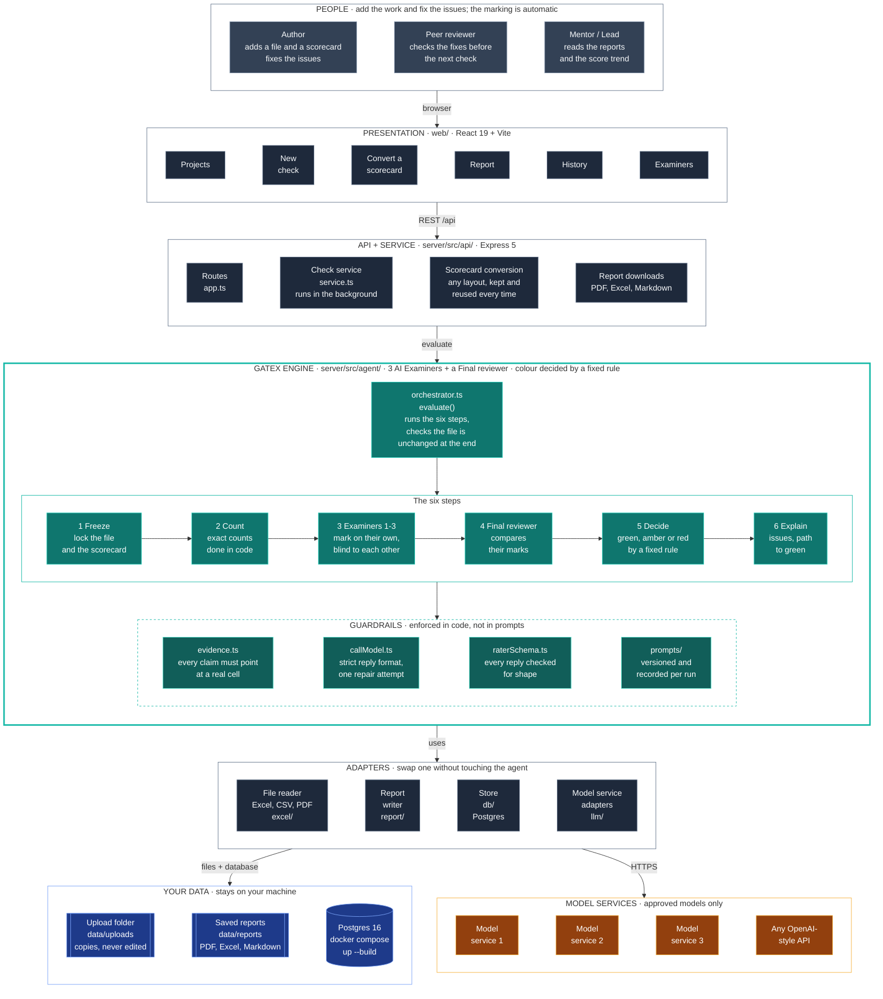
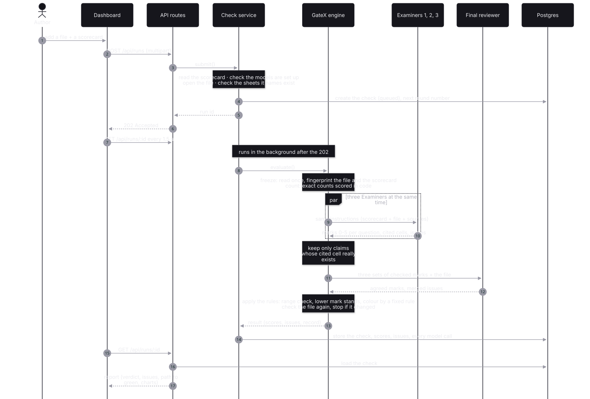

# Architecture

This page describes how GateX is put together: the parts, how they talk, where the data lives, and how it is
deployed. For what the GateX engine does with your file, see [agent.md](agent.md).

## Contents

1. [Goals and constraints](#goals-and-constraints)
2. [System context](#system-context)
3. [Layers](#layers)
4. [Dependency rules](#dependency-rules)
5. [One evaluation, end to end](#one-evaluation-end-to-end)
6. [The iteration loop](#the-iteration-loop)
7. [Data model](#data-model)
8. [Runtime model](#runtime-model)
9. [Deployment](#deployment)
10. [Keeping steady](#keeping-steady)
11. [Observability](#observability)
12. [Technology](#technology)

## Goals and constraints

GateX carries out **Level 1** of the Agentic Roadmap: every deliverable is scored against its scorecard. That fixes the shape of the design.

| Goal | What it means for the design |
|---|---|
| Trustworthy scores | Everything that can be counted is counted in code; the Examiners only judge what needs judging, and every claim they make is checked against the file |
| Auditable | Every input, prompt, raw reply, score and decision is stored; any result can be explained |
| Independent | GateX never edits the work it judges and never shares a session with the author; Examiners 1, 2 and 3 come from different model families |
| Automatic | Every question is marked and the colour decided by a fixed rule, with nobody waiting; a scorecard in any layout is converted once and reused |
| Open about how a result was made | Every step is recorded and the report says how it was produced (flags, notes, set-aside claims) |
| Small and replaceable parts | Providers, storage and report formats sit behind thin adapters |

GateX evaluates; you fix. That keeps the evaluator independent of the work it judges.

## System context



Three kinds of people use it. The **author** adds a file and a scorecard and fixes the issues. The **peer reviewer** checks the fixes
before the next check. The **mentor or lead** reads the reports and the score trend. Nobody has to approve a scorecard or a
result: scoring is automatic ([ADR-17](decisions.md#adr-17-fully-automatic-scoring-no-person-in-the-loop)).

## Layers



> The same diagram as a static image (for viewers that do not draw Mermaid): [`images/architecture.svg`](images/architecture.svg).

| Layer | Folder | Responsibility |
|---|---|---|
| Presentation | `web/` | The dashboard: projects, check a new file, live progress, report, history, models. Talks only to `/api` |
| API + service | `server/src/api/` | HTTP routes, request validation, uploads; `EvaluationService` validates a submission, stores it and runs the check in the background |
| **GateX engine** | `server/src/agent/` | The six steps, the safeguards and the decision rule. No knowledge of HTTP, databases or report formats |
| Adapters | `excel/`, `llm/`, `report/`, `db/` | One job each: read a file, call a model service, write a report, keep data |
| Shared contract | `shared/` | Types and the scorecard schema used by both server and dashboard |

## Dependency rules

Dependencies point **inwards** towards the engine, and the engine depends on very little:

```
web  ──►  /api  ──►  api/  ──►  agent/  ──►  llm/ · excel/ · util/
                      │            ▲
                      ├──►  db/ ───┘ (types only)
                      └──►  report/ ──►  agent/ (verdict, path to green)
```

- `agent/` imports only `llm/`, `excel/`, `util/` and a config type. It does not import `api/`, `db/` or `report/`.
- `llm/`, `excel/` and `scorecard/` never import `agent/`.
- Everything outside `agent/` reaches it through its single door, [`agent/index.ts`](../server/src/agent/index.ts).

Because the engine knows nothing about Express or Postgres, it can be run from the command line (`npm run evaluate`) and tested without a server.

## One evaluation, end to end



How it flows:

- The `POST /api/runs` call **returns at once** with `202 Accepted`. The evaluation continues in the background and
  the dashboard polls `GET /api/runs/:id` every 1.5 seconds, showing which stage is running and which model has answered.
- Everything about a submission (the scorecard, the sheet names, the models, the file type) is checked **before**
  anything is stored or any model is called, and any problem comes back as a plain-language message.
- The three Examiners run at the same time; the Final reviewer runs after them.
- The report you read is **assembled on read** from the stored, unchanging result plus any override recorded through
  the API. An override never changes the agent's own scores.

## The iteration loop



This is PDF page 12. GateX produces the verdict and the path to green; **you** fix the file and check it again. Each
check becomes a new round (iteration) of the same project, scored independently. Adding a file under an existing project name adds a round to it, so
the score trend, the fixed / still-open / new issues and the per-question heatmap build up automatically.

An issue's identity across rounds (`fingerprint`) is the question for code issues (the failing cell moves
as rows get fixed) and question + cell for Examiner issues.

## Data model



| Table | Holds |
|---|---|
| `projects` | The work being checked round after round; name is unique |
| `runs` | One check: status and stage, both hashes, a frozen copy of the scorecard, the unchanging `core` (the result), the `run_log`, the score and the GateX / final decision |
| `model_calls` | Every model call: provider, model, family, exact prompt, raw reply, discarded claims, tokens, latency |
| `dimension_scores` | Each question's score, spread, Examiner marks and flag, queryable for trends |
| `findings` | Each issue with its location, fix and fingerprint |
| `overrides` | A person's override of a verdict, with the required reason |

Migrations are plain SQL in `server/src/db/migrations/`, applied once each in name order, on server start or with
`npm run db:migrate`. There is no ORM. The same SQL runs on real Postgres and on the in-memory Postgres (`pg-mem`)
used for tests and the no-Docker demo.

## Runtime model

- **One Node process** serves the API and, in production, the built dashboard.
- **Checks run in-process**, in the background of the request that started them. There is no separate queue
  or worker, which keeps the system small. On the next start, any run that was still "queued" or "running" is
  closed with a clear message ("Submit it again"), so the list is always up to date.
- **Concurrency**: several checks can run at once. Service rate limits are handled by the HTTP layer
  (retry with back-off, honouring `Retry-After`).
- **State**: the database holds all state. The only files are the uploaded workbooks (`data/uploads/`), kept as
  read-only copies so a run can be re-examined.

## Deployment



| Mode | How |
|---|---|
| Demo | `MOCK_LLM=1 npm run start`: scripted models, in-memory database, no keys, no Docker |
| Local, real | `docker compose up -d db`, keys in `.env`, `npm run start` |
| Whole app in Docker | `docker compose up --build`: GateX and Postgres together |
| Shared / production | The same, on a VM, behind a reverse proxy that adds HTTPS and sign-in (see [security.md](security.md)) |

A single process is sufficient for a team. To grow beyond it, the natural step is to move
`EvaluationService.execute` onto a job queue and run several workers; the engine needs no change, because it is
a function of its inputs apart from the model calls.

## Keeping steady

How GateX handles a busy model service is described in [agent.md](agent.md#6-staying-steady-when-a-service-is-busy). At system level:

| Situation | What happens |
|---|---|
| Postgres is restarted | The app reconnects on the next request, and everything stored is still there |
| The server restarts mid-run | The run is closed with a clear message on the next start, and you add the file again |
| A model service is busy or rate-limited | Requests are retried, then fallback models answer; the report names the model that answered |
| The uploads folder moves | Set `DATA_DIR` to point at it |

## Observability

- The server logs one line per notable event to the console, prefixed `[ddd]`: start-up, migrations, roster
  problems, interrupted runs, unhandled errors. API keys are never logged.
- `GET /api/health` returns `{ ok: true, db: "postgres" | "memory" }` for liveness checks.
- Per-run observability is in the data: the `run_log` (timings, tokens, attempts per model) and `model_calls`.

## Technology

| Concern | Choice | Why (details in [decisions.md](decisions.md)) |
|---|---|---|
| Language | TypeScript (strict), Node 22, ES modules | One language across agent, API and dashboard |
| API | Express 5 | Small, well known, async errors handled |
| Dashboard | React 19, React Router 7, Vite | Plain CSS with design tokens; no UI framework |
| Database | Postgres 16 (Docker), `pg` driver, plain SQL | Durable and inspectable; same SQL runs in-memory for tests |
| Models | Plain HTTPS to each service; no agent framework | The flow is fixed; every rule must be enforceable and testable |
| Validation | Zod at every boundary (scorecard, requests, model replies) | Untrusted input is checked once, at the edge |
| Excel | Custom read-only reader (input), ExcelJS (report output) | Opens every sample file, and only ever reads |
| Tests | Vitest; scripted mock models | Repeatable, fast, and able to simulate models that answer badly |
