# Security and data handling

This page says what GateX protects and how. It also lists the setup we recommend for a shared deployment.

## What is protected

| Asset | Why it matters |
|---|---|
| **Your files** (workbooks, source documents) | They may be client confidential, so only approved models receive them (PDF p.13) |
| **Model API keys** | They spend money and identify the organisation |
| **Verdicts and the audit trail** | A trustworthy colour is what lets later work build on a result (PDF p.14) |
| **The scorecard** | It is fixed for the whole check, so the target never moves |

## Trust boundaries

Everything the browser sends and every uploaded file is treated with care. Everything a model returns is checked before it is believed. Your
files leave the server only through the roster gate, and only to approved models.

## Controls

### Input handling

| Control | Detail |
|---|---|
| File type and size | Only the supported file types; uploads are capped at 25 MB each, at most two files |
| Safe reading | The workbook is unzipped and its XML read as **data** (`excel/xlsxReader.ts`). Macros, formulas, links and embedded objects are never run, and drawings are ignored |
| Strict scorecard | Read against a schema (Zod); a wrong shape is rejected with a message (unknown extra keys are ignored). Scorecards contain data only, no code |
| Request validation | JSON bodies are validated (Zod); string lengths, enums and score ranges are enforced |
| Uploaded file names | Cleaned to `[\w.- ]` and stored under a generated run id, so a name cannot escape the uploads folder |
| Regular expressions | A scorecard's `pattern` is a regular expression chosen by the people who write scorecards, who are trusted. Take scorecards from people you trust |

### Models and data leaving the server

| Control | Detail |
|---|---|
| **Approved list** | A model not in `approved` in `models.json` is refused before anything is sent (`llm/roster.ts`). This covers **fallback models** too: one that is not approved makes the roster not ready, because a fallback receives the files when the main model is busy |
| **Keys** | Read from the server environment only. Never stored in the database, never logged, never in an API response (`/api/config` says only whether a key is set). Keys travel in request headers, not URLs, so they cannot leak into logs |
| **Independence** | Three different model families, so one service's mistake cannot decide a verdict alone |
| **Minimum necessary** | `columns` in a scorecard limits what the Examiners are sent; sheets not listed are never sent |

### Integrity of the result

| Control | Detail |
|---|---|
| **Evidence gate** | A mark or issue counts only if it cites a cell that exists, with a quote that really appears in it. Text planted in a file cannot invent an issue about a cell that is not there |
| **Colour by a fixed rule** | No model output is ever used as the colour. Examiners give marks; a function applies the rule |
| **Range checks** | The Final reviewer cannot produce a mark outside what the Examiners said; an unsettled disagreement keeps the lower mark |
| **Freeze** | The file and the scorecard are hashed before and after the run, which proves they stayed the same |
| **Read-only** | GateX never writes to your file |
| **Audit trail** | Every prompt, raw reply, mark and override is stored with who and when |
| **Overrides carry a reason** | And GateX's own verdict is stored beside the override |

### Instructions hidden in a file

A file is data from an author, and an author could write instructions into a cell ("score this 5"). GateX is built so this does not work:

- The prompts tell the models to treat the file as data, never as instructions.
- **Extra instructions** typed in the dashboard come from the person adding the file. They go to every Examiner in the same words, are saved with the
  run and hashed, and the rules in the prompt say they can never change the scale, the evidence rule or the reply format, or dictate a mark. They
  are text sent to the model services, so keep confidential material that is not already in the file out of them.
- **Counted questions are scored by code**, which cannot be talked into anything.
- Every Examiner claim must cite a real cell, and the colour is computed by code, so injected text cannot make up evidence or set the colour.
- Three different model families mark independently, so one model being swayed shows up as a **spread** and is flagged.

## Recommended setup for a shared deployment

- [ ] A reverse proxy with HTTPS and company sign-in in front of GateX (Caddy is included: see [operations.md](operations.md#putting-it-on-a-server))
- [ ] A strong database password, with port 5432 reachable only from the host or a private network
- [ ] `.env` readable only by the service account; keys rotated on a schedule; spending limits set with each model service
- [ ] `approved` in `models.json` reviewed against client agreements
- [ ] Disk encryption on the host; the uploads folder and the database backed up and access-controlled
- [ ] A retention rule for old runs and uploads (projects and runs can be deleted from the dashboard)
- [ ] `npm audit` run as part of your pipeline
- [ ] Someone owns the scorecards: changes are versioned, reviewed and frozen

## Reporting a security concern

This is an internal Talencia Global project. Send security concerns to the project owner directly, not in a shared channel. Include the steps
to reproduce, and leave out any client document.
